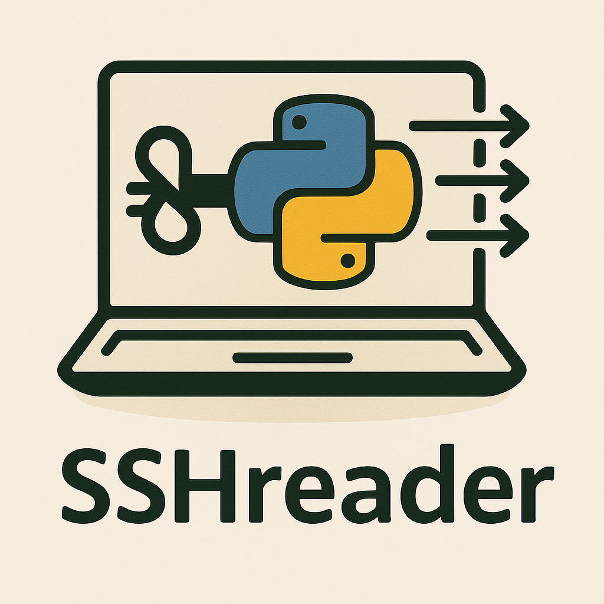

[](https://github.com/isaiah1112/sshreader/actions/workflows/lint_and_test.yml)

# SSHreader

SSHreader is a Python library for running commands on multiple servers in parallel. It wraps [Paramiko](https://www.paramiko.org/) and provides both a direct SSH client and a job-based interface for parallel SSH and local shell work. It also includes `pydsh`, a command-line tool for running commands across host lists.

SSHreader supports Python 3.11 and later.

## Installation

Install the latest release from PyPI:

```bash
python -m pip install sshreader
```

## Quick start

Use `SSH` to run commands in a single SSH session. SSHreader can use an SSH key, an SSH agent, or a password:

```python
from sshreader import SSH

with SSH("myhost.example.com", username="jdoe", keyfile="~/.ssh/id_ed25519") as ssh:
    result = ssh.ssh_command("uname -a")
    print(result.stdout)
    print(result.return_code)
```

Use `ServerJob` and `sshread` to run jobs on multiple hosts. A job can contain multiple commands, which run sequentially on that host:

```python
from sshreader import ServerJob, sshread

hosts = ["server1.example.com", "server2.example.com"]
jobs = [
    ServerJob(host, ["hostname", "uptime"], username="jdoe", keyfile="~/.ssh/id_ed25519")
    for host in hosts
]

finished_jobs = sshread(jobs, tcount=0)
for job in finished_jobs:
    print(job.name, job.status)
    for result in job.results:
        print(result.cmd, result.stdout, result.stderr, result.return_code)
```

`tcount=0` selects a thread count based on the available CPUs and number of jobs. Use `pcount=0` to enable multiprocessing; you can also combine process and thread workers. When using multiprocessing, put the call to `sshread` inside the standard `if __name__ == "__main__":` guard.

Each command result has `cmd`, `stdout`, `stderr`, and `return_code` fields. A `ServerJob` stores its command results in `results` and the sum of their return codes in `status`.

## Other features

- Run one or more commands over a reusable SSH connection with `SSH.ssh_command`.
- Transfer files over SFTP with `SSH.sftp_put` and `SSH.sftp_get`.
- Run local commands with `shell_command` (shell-free by default; use `shell=True` only when needed) or create local `ServerJob` instances with `run_local=True`.
- Use `Hook` objects to run functions before or after a job, including hooks that use its established SSH connection.
- Discover the current username, SSH keys, and agent keys with `envvars()`.
- Configure connection and command timeouts, SSH ports, output handling, and worker counts.

See the [documentation](https://sshreader.readthedocs.io/) for detailed API guides and examples.

## `pydsh`

Installing SSHreader also installs the `pydsh` command. It accepts [hostlist expressions](https://pypi.org/project/python-hostlist/) and runs a command across the expanded hosts:

```bash
pydsh -w 'web[01-10].example.com' 'uname -r'
```

By default, `pydsh` uses the current username and available SSH keys or agent, prompting for a password when needed. You can specify credentials and group or coalesce output:

```bash
pydsh -u jdoe -k ~/.ssh/id_ed25519 -D -w 'web[01-10].example.com' 'uname -r'
```

Use `pydsh --help` to see all options. With `-F`, the command argument is treated as a script file; the script must start with a shebang (`#!`), and `--confirm` skips the execution confirmation prompt.

## Development

To set up a local development environment and run the tests:

```bash
uv sync --group test
uv run --group test pytest
```

Run lint and type checks with:

```bash
uv run --group test ruff check sshreader tests
uv run --group test ty check sshreader
```

## Contributing

Bug reports, feature requests, and code contributions are welcome. Please [open an issue](https://github.com/isaiah1112/sshreader/issues) with a minimal example and relevant traceback when reporting a problem. Contributions can be submitted as pull requests to the [GitHub repository](https://github.com/isaiah1112/sshreader).

## License

SSHreader is released under the [GNU Lesser General Public License v3.0 or later](https://www.gnu.org/licenses/lgpl-3.0.html). See [LICENSE](./LICENSE) and [LICENSE.lesser](./LICENSE.lesser) for the license texts.
